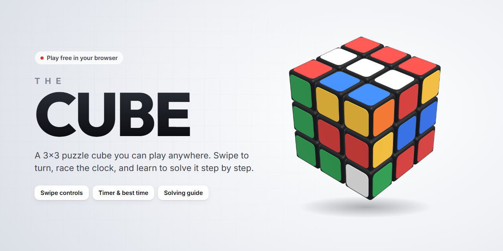
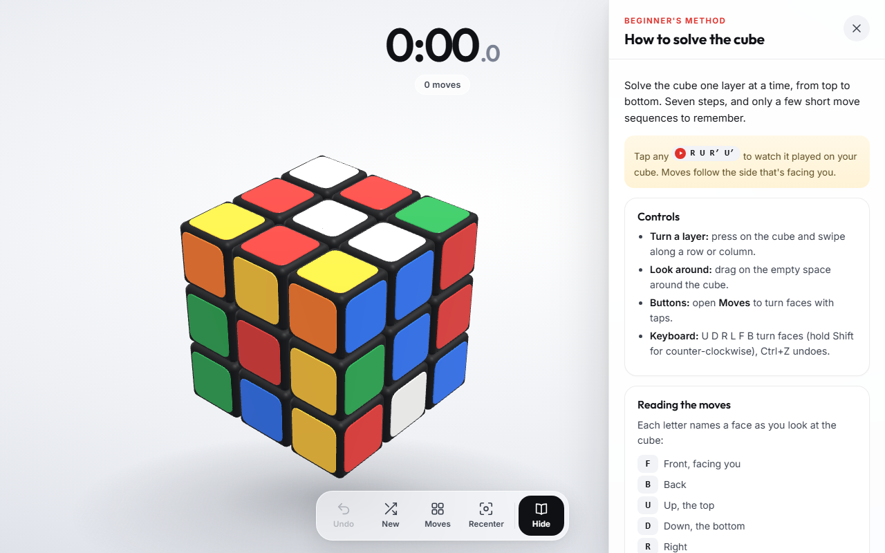
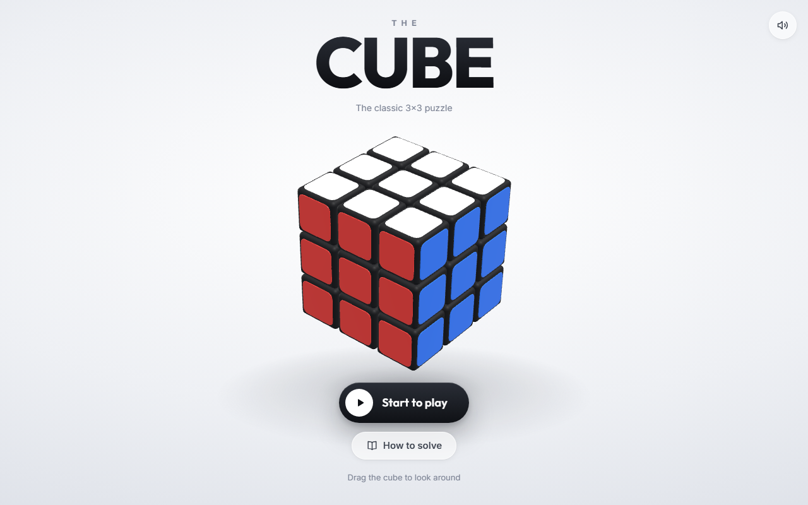
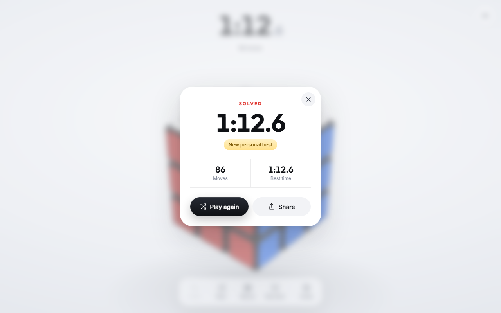
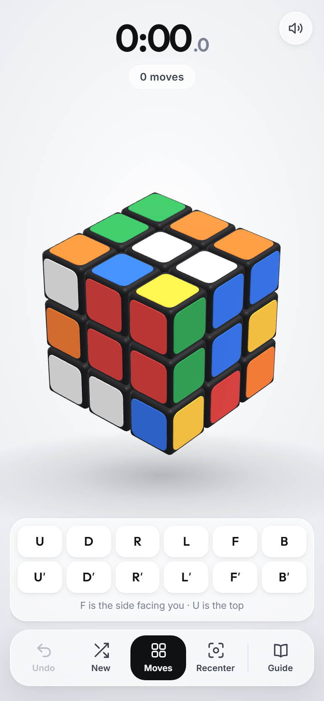

<div align="center">

<a href="https://the-cube-game.vercel.app">
  
</a>

<br>
<br>

[](https://the-cube-game.vercel.app)


[](LICENSE)

**A 3×3 puzzle cube you can play right in your browser.**<br>
Swipe to turn, race the clock, and learn to solve it with the built-in step-by-step guide.

[Features](#features) · [Screenshots](#screenshots) · [Controls](#controls) · [How to solve](#how-to-solve) · [Run locally](#run-locally)

</div>

<br>

## Features

<table>
  <tr>
    <td width="50%" valign="top">
      <h4>🧊 Realistic 3D cube</h4>
      Rounded pieces, glossy stickers, soft studio lighting and a shadow underneath. Turns settle into place like real plastic.
    </td>
    <td width="50%" valign="top">
      <h4>👆 Natural controls</h4>
      Swipe any row or column to turn it. Drag around the cube to look at it from any side; flick it and it keeps gliding.
    </td>
  </tr>
  <tr>
    <td valign="top">
      <h4>⏱️ Timer and personal best</h4>
      A fresh scramble every game. The clock starts on your first move, counts your moves and remembers your best time.
    </td>
    <td valign="top">
      <h4>📖 Solving guide you can hide</h4>
      A 7-step beginner's method beside the cube. Tap any sequence to watch it played, or hide the guide and solve on your own.
    </td>
  </tr>
  <tr>
    <td valign="top">
      <h4>📱 Works everywhere</h4>
      Built for phones, tablets and computers. On a keyboard, letters turn faces and <kbd>Ctrl</kbd> + <kbd>Z</kbd> undoes.
    </td>
    <td valign="top">
      <h4>🎉 Feels rewarding</h4>
      Turning sounds, gentle vibration on supported phones, and confetti with a results card you can share when you solve it.
    </td>
  </tr>
</table>

## Screenshots

<p align="center">
  
  <br>
  <sub><b>Playing with the guide open.</b> Moves in the guide can be played on the cube with one tap.</sub>
</p>

<table>
  <tr>
    <td width="38%" align="center" valign="top">
      
      <br><sub><b>Start screen</b></sub>
      <br><br>
      
      <br><sub><b>Results card</b></sub>
    </td>
    <td width="24%" align="center" valign="top">
      
      <br><sub><b>On a phone</b>, with the turn buttons open</sub>
    </td>
  </tr>
</table>

## Controls

| Action | Touch or mouse | Keyboard |
| :-- | :-- | :-- |
| Turn a layer | Swipe along a row or column | <kbd>U</kbd> <kbd>D</kbd> <kbd>R</kbd> <kbd>L</kbd> <kbd>F</kbd> <kbd>B</kbd> |
| Turn counter-clockwise | Swipe the other way | Hold <kbd>Shift</kbd> |
| Look around | Drag the empty space | – |
| Undo | **Undo** button | <kbd>Ctrl</kbd> + <kbd>Z</kbd> |
| Turn with buttons | Open **Moves** | – |
| Hide the guide | **Hide** button | <kbd>Esc</kbd> |

Face letters are always read from your current view: **F** is the side facing you and **U** is the top.

## How to solve

The game includes a full illustrated guide. Here is the short version:

| Step | Goal | Sequence |
| :-: | :-- | :-- |
| 1 | **White cross** on top, edge colours matching the centres | Solve by experimenting |
| 2 | **White corners** (flip the cube so white is on the bottom) | `R U R' U'` |
| 3 | **Middle layer** edges | `U R U' R' U' F' U F` or `U' L' U L U F U' F'` |
| 4 | **Yellow cross** on top | `F R U R' U' F'` |
| 5 | **Match the yellow edges** to their centres | `R U R' U R U2 R' U` |
| 6 | **Place the yellow corners** | `U R U' L' U R' U' L` |
| 7 | **Twist the yellow corners** until solved | `R' D' R D` |

<details>
<summary><b>How to read the moves</b></summary>
<br>

| Letter | Face |
| :-: | :-- |
| **F** | Front, facing you |
| **B** | Back |
| **U** | Up, the top |
| **D** | Down, the bottom |
| **R** | Right |
| **L** | Left |

- A letter on its own means a quarter turn **clockwise**, as if you were looking straight at that face.
- A `'` (prime) means **counter-clockwise**.
- A `2` means turn that face **twice**.

</details>

## Built with

- **HTML, CSS and plain JavaScript**, with no frameworks and no build step
- **[three.js](https://threejs.org/)** for real-time 3D rendering, with physically based materials and a generated studio environment for reflections
- **Web Audio API** for sound effects generated in code, so there are no audio files to load

<details>
<summary><b>Project structure</b></summary>
<br>

```
the-cube/
├── index.html                  Page layout and the solving guide
├── assets/
│   ├── css/style.css           Design tokens, layout and animation
│   ├── js/game.js              Cube model, rendering, input and game flow
│   └── vendor/three.min.js     three.js r128 (MIT licence)
└── docs/images/                README banner and screenshots
```

`game.js` is organised into twelve labelled sections, from utilities and audio through the cube model, layer turning, input and camera framing to the main loop.

</details>

## Run locally

No installation is needed.

```bash
git clone https://github.com/mahmudultopu/the-cube.git
cd the-cube
```

Then open `index.html` in your browser. If your browser blocks local files, serve the folder instead:

```bash
npx serve .
```

### Deploy your own copy

The project is a static site, so any static host works, including GitHub Pages, Vercel and Netlify. With Vercel:

```bash
npx vercel deploy --prod
```

## License

Released under the [MIT License](LICENSE). three.js is included under its own MIT licence.

<br>

<div align="center">
  <sub>Made by <a href="https://github.com/mahmudultopu">Mahmudul Hasan Topu</a>. If you enjoy the game, a ⭐ on the repository is appreciated.</sub>
</div>
